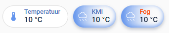

The heading badge only has three elements but can show key information in very little space. As standard however it allows little customisation, we can override `name`, set `icon` and choose the icon `color`. We cannot change the state and we cannot use templates. In this guide we will show how to add templating capability to all three elements (icon, name and state).

The badges below show the current temperature as reported by a weather service, the first one is a standard badge.



UIX can forge `name` and `icon` and add template capability to both, but not the state because the badge has no entry key for the state. We can get around this limitation by using the search spark, which can look for a specific text and change it into a different text (which can be a template). For this to work the state needs to be a fixed string so the search spark knows what to look for. The only way to achieve this is by setting `state_content: name` and setting this to a fixed string `name: LookForThis`. Take a look at the second badge to see what this achieves.

Now we can add two sparks to change both the state and the name to something else (for this specific example forging the name and icon would have been possible without the sparks but by using them we can also catch unavailability of the state).



```
type: custom:uix-forge
forge:
  mold: badge
  sparks:
    - type: search
      for: hui-entity-badge $
      query: state-display
      actions:
        replace_text:
          find: name
          replace: >
            
              {{ states('sensor.tulpenlaan_current_temperature', with_unit=true) }}
            
              {{ ' °C' }}      
            
    - type: search
      for: hui-entity-badge $ ha-badge $
      query: span.label
      actions:
        replace_text:
          find: name
          replace: >
            
              {{ 'KMI' }}       {{
            warnings[0:9] }} 
element:
  type: entity
  entity: sensor.tulpenlaan_current_temperature
  state_content: name
  show_name: true
  name: name
  icon: |-
    
    
    
    {{ 'local:material-symbols-light--cloud-outline-rounded' }}
    
    {{ 'local:material-symbols-light--partly-cloudy-day-outline-rounded' }}
    
    {{ 'local:material-symbols-light--partly-cloudy-night-outline-rounded' }}
    
    {{ 'local:material-symbols-light--wb-sunny-outline-rounded' }}
    
    {{ 'local:material-symbols-light--rainy-light-outline-rounded' }}
    
    {{ 'local:material-symbols-light--rainy-outline-rounded' }}
    
    {{ 'local:material-symbols-light--rainy-heavy-outline-rounded' }}
    
    {{ 'local:material-symbols-light--moon-stars-outline-rounded' }}
    
    {{ 'local:material-symbols-light--sunny-snowing-outline-rounded' }}
    
    {{ 'local:material-symbols-light--weather-snowy-outline-rounded' }}
    
    {{ 'local:material-symbols-light--mist-outline-rounded' }}
    
    {{ 'local:material-symbols-light--weather-hail-outline-rounded' }}
    
    {{ 'local:material-symbols-light--thunderstorm-outline-rounded' }}
    
    {{ 'local:material-symbols-light--thunderstorm-outline-rounded' }}
    
    {{ 'local:material-symbols-light--weather-snowy-outline-rounded' }}
    
    {{ 'local:material-symbols-light--air-outline-rounded' }}
    
    {{ 'local:material-symbols-light--air-outline-rounded' }}
    
    {{ 'local:material-symbols-light--cyclone-outline-rounded' }}
    
    {{ 'local:material-symbols-light--partly-cloudy-day-outline-rounded' }}
    
  tap_action:
    action: more-info
    entity: weather.tulpenlaan
  double_tap_action:
    action: more-info
    entity: camera.radar_tulpenlaan
```
